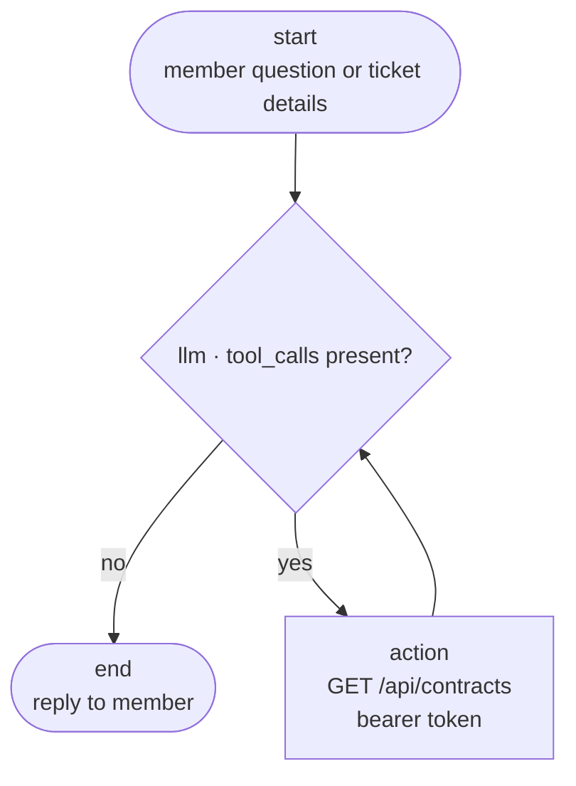

# Ticketing AI Assistant

An agent that lets non-technical IT operations staff resolve ticket lookups in plain
language, instead of escalating to a developer.

> **Coming back to this later?** Read [`docs/REFERENCE.md`](docs/REFERENCE.md) — it
> records why the project is built this way, every decision that is easy to forget, and
> every problem hit along the way with its symptom and fix.
>
> **Tracing a request?** [`docs/CALL-FLOW.md`](docs/CALL-FLOW.md) walks a question
> from the browser through the embedded Python interpreter and back, step by step,
> with the reasoning behind each hop.

Two applications:

| App | Stack | Responsibility |
|---|---|---|
| `src/OpsLookup.Api` | .NET 10 Web API, EF Core, SQL Server | Owns all data access. JWT bearer auth. |
| `src/OpsLookup.Graph` | Python 3.12+, LangGraph, LongCat | Orchestration only. No database driver anywhere. |

The split is deliberate: **SQL Server is reachable only from the .NET project.** The
Python service holds an HTTP client and a bearer token. It cannot execute SQL, and no
code path lets it try.

## Workflow



One conditional edge. A clarifying question and a final answer travel the same path:
both are plain text with no tool call, and both flow to `end`.

## Data model

`Contract (Id PK, Name, Code, CreatedDate)`

`Party (Id PK, Name, ContractId FK, SocialId, AttorneyId FK, CreatedDate)`

`Attorney (Id PK, Name, Status, CreatedDate)`

Social IDs are 10 digits and always start with 1 or 2. Because they cannot start with
zero, `bigint` is safe here — a leading zero can never be lost.

`Attorney.Status` is `approved` or `faked`. It is validated in C# *and* constrained by
a `CK_Attorney_Status` check constraint, so an invalid value cannot arrive by any route.
`Party.AttorneyId` is nullable: a party may have no attorney on file.

## Swagger UI

Start the API and open **http://localhost:5250/swagger**.

Port note: `launchSettings.json` binds `http://localhost:5250` and
`https://localhost:7163`. The ASP.NET Core development certificate is self-signed, so
point `.env` at the **http** URL — httpx will refuse the https one with
`CERTIFICATE_VERIFY_FAILED`. See `SSL_CERT_FILE` in `.env.example` if you need https.

Getting a token is a two-step flow inside the page:

1. Expand `POST /auth/dev-token`, click **Try it out** → **Execute**. No token needed.
2. Copy the `accessToken` value from the response body.
3. Click **Authorize** at the top of the page and paste it. The `Bearer ` prefix is
   optional.

`/api/contracts` then executes straight from the browser. The lock icon appears only on
the endpoints that actually require a token; `/health` and `/auth/dev-token` are
deliberately shown unlocked.

The raw document is at `/openapi/v1.json`.

## API

```
GET  /api/contracts?socialId={long}&name={string?}      -> 200 / 400 / 401
GET  /api/attorneys?socialId={long?}&partyName={string?} -> 200 / 400 / 401
POST /auth/dev-token                                  Development only
GET  /health                                          anonymous
```

`socialId` is required, `name` is optional and filters on **party name**.

```json
[
  {
    "contractCode": 100234,
    "socialId": 1234567890,
    "partyName": "A Nasser",
    "contractName": "Annual Maintenance Agreement"
  }
]
```

An empty array means no contracts matched. It is not an error.

A malformed social ID returns **400** with `"Social ID must be 10 digits starting with 1
or 2."` rather than an empty array. Without that, a member who mistypes an ID reads "no
contracts found" as "this customer does not exist" — a wrong answer rather than a failed
lookup.

### Attorneys

`socialId` and `partyName` are both optional but **at least one is required** — with
neither, the endpoint would return every attorney on file, which is a data dump rather
than a lookup.

```json
[
  {
    "attorneyId": 1,
    "attorneyName": "Lena Fischer",
    "status": "approved",
    "partyId": 3,
    "partyName": "B Karimi",
    "socialId": 1987654321
  }
]
```

The response includes the matched party, not just the attorney, so the answer can be
confirmed to be about the party that was asked about.

Parties with no attorney on file are excluded. `[]` therefore means "no attorney on file
for that party", which is a different answer from "the attorney is approved".

All requests require `Authorization: Bearer <token>`; missing or invalid tokens get 401.

## Running it

### Web page

```powershell
cd src\OpsLookup.Graph
.\.venv\Scripts\uvicorn api:app --port 8000
```

Open **http://localhost:8000**. A chat page for operations staff to type ticket
descriptions in plain language and read the agent's answer.

The page is a single self-contained `static/index.html` — no build step, no CDN, no
external requests, so it works on an isolated network. It is served from the same
origin as the API, so there is no CORS setup.

| Behaviour | Why |
|---|---|
| Ticket id kept in `localStorage` | A follow-up question keeps its conversation context |
| Lookup badge under each answer, in three colours | Staff can see whether the answer came from the database. Green = read from SQL, amber = never looked, red = the lookup ran but failed. See the badge section below. |
| Example prompts on the empty state | The audience is non-technical; it shows what to type |
| Enter sends, Shift+Enter newlines | |
| Dark mode, `aria-live` log | |

## Language

Arabic by default, with an Arabic/English switch in the header. Choosing a language
flips `dir` on `<html>`, so the whole layout mirrors to RTL — Tailwind's logical
utilities (`ps-`, `me-`, `text-start`) handle it, so the components carry no
direction-specific branches.

**The agent answers in the selected language.** The page passes `locale` on
`/api/chat`, and `graph/build.py::system_prompt()` picks `SYSTEM_PROMPT_AR` or
`SYSTEM_PROMPT_EN` from it. Without that you get an Arabic page beside an English
answer.

Two things stay untranslated on purpose:

- **Social IDs and contract codes**, always in Western digits (`1234567890`). Arabic
  business users read Latin digits, and a social ID is data — Arabic-Indic numerals
  would make the number wrong.
- **Names and statuses from the database**, left exactly as the tool returned them.
  `faked` stays `faked`, with the Arabic meaning explained next to it. Translating or
  transliterating data makes the answer wrong.

The system prompts are two separate strings, deliberately kept in step. If you add a
rule to one, add it to the other or members get different behaviour depending on which
language they picked.

### The lookup badge

`toolCalls` counts tool **invocations**, not successes, so it cannot by itself answer
"was this verified?". A turn where the API rejected the token still reports 1 lookup.
Both tools return failures as `{"error": ...}` text rather than raising, so
`graph/build.py::any_tool_error` reads the signal back out of the transcript and the API
returns `lookupFailed` alongside `toolCalls`.

The badge then has three honest states rather than two:

| State | Means |
|---|---|
| Green, "Looked up N times in the database" | Rows were actually read |
| Amber, "Not checked against the database" | The model answered without calling a tool |
| Red, "Lookup failed — not verified" | A tool ran and failed. Nothing was read. |

One subtlety worth keeping: `any_tool_error` only inspects messages **after the last
`HumanMessage`**. The checkpointer replays the whole thread, so a failure from an
earlier turn is still in the list — scanning all of it would mark a later good answer
as failed because of something that happened before.

### 1. API

```powershell
cd src\OpsLookup.Api
dotnet run
```

On startup in Development it applies migrations and seeds four sample contracts. The
connection string defaults to LocalDB in `appsettings.Development.json`; change
`ConnectionStrings:ContractDb` to point at your own server.

### 2. Mint a token

```powershell
curl.exe -X POST "http://localhost:5250/auth/dev-token?operatorId=op-4471"
```

Put the returned `accessToken` in the Python service's `.env` as `API_TOKEN`. It is
signed with the same key the API validates, so the two must share `Jwt:SigningKey`.

### 3. Graph service

```powershell
cd src\OpsLookup.Graph
python -m venv .venv
.\.venv\Scripts\pip install -r requirements.txt
Copy-Item .env.example .env      # then fill in LONGCAT_API_KEY and API_TOKEN
.\.venv\Scripts\uvicorn api:app --reload --port 8000
```

`LONGCAT_BASE_URL` must be `https://api.longcat.chat/openai/v1` with model
`LongCat-2.5-Preview`. The OpenCode Zen endpoint (`opencode.ai/zen/go/v1`) cannot be
called directly — it needs an internal `x-opencode-session` header and returns
`MissingSessionID`.

### 4. Try it

```powershell
curl.exe -X POST http://localhost:8000/chat -H "Content-Type: application/json" `
  -d '{"ticket_id":"T-1001","message":"Can you check what contracts are held for social ID 1234567890?"}'
```

Send more messages with the same `ticket_id` to continue the thread — the checkpointer
restores the conversation, which is what lets the agent ask a follow-up question.

## Adding a lookup

1. Add the tool in `src/OpsLookup.Graph/tools/` with typed parameters — `contracts.py`
   for contracts, `attorneys.py` for attorneys.
2. Add the endpoint in `src/OpsLookup.Api/Endpoints/`.
3. Add the tool to the list in `graph/build.py` **and** mention it in `SYSTEM_PROMPT`.
4. Register it where the tools are assembled: `build_tools(client) + build_attorney_tools(client)`
   in both `api.py` and `host.py`.
5. Copy the Python file into `src/OpsLookup.NetCorePythonNetApp/Python/tools/`. The two
   Python trees are deliberate physical copies, so they drift unless you copy.

The model chooses among named tools and supplies typed arguments. It never emits SQL, a
table name, or a filter expression.

Step 3 is not optional. A tool the model has never been told about goes uncalled, and
every answer becomes a guess. `toolCalls: 0` in a `/chat` response is the signal — see
`docs/REFERENCE.md` §7.

## Tests

### `Check API.ipynb` — 23 checks, end to end

Covers the .NET API (auth, lookup, name filter, social ID validation, 401) and the
LangGraph loop (tool routing, thread continuity) plus an optional real-LongCat pass.

It needs a kernel in the project venv, otherwise notebooks silently fall back to a
system Python without `langgraph`:

```powershell
cd src\OpsLookup.Graph
.\.venv\Scripts\pip install -r requirements-dev.txt
.\.venv\Scripts\python -m ipykernel install --user --name opslookup --display-name "opslookup (Python 3.14)"
```

Then open the notebook and select the **opslookup (Python 3.14)** kernel.

Two things to know if you adapt it:

- **Never call `asyncio.run()` in a cell.** Jupyter already runs an event loop, so it
  raises `RuntimeError: cannot be called from a running event loop`. Use `await`.
- The notebook mints its own token from `/auth/dev-token`, so `API_TOKEN` is optional.

### `smoke_test.py` — same checks, headless

20 assertions across 8 groups: graph routing, thread continuity, the contract tool, and
the attorney tool (by social ID, by partial party name, the no-attorney case, and a
rejected social ID). Uses a stubbed model, so no LongCat key is needed.

```powershell
cd src\OpsLookup.Graph
.\.venv\Scripts\python.exe smoke_test.py
```

It needs the .NET API running and a fresh `API_TOKEN` — dev tokens last 60 minutes.
Refresh with:

```powershell
$tok = Invoke-RestMethod "http://localhost:5250/auth/dev-token?operatorId=op-4471" -Method Post
```

## Notes

- **Never put a real token or API key in `.env.example`.** It is committed to git; `.env`
  is ignored. Both example files must stay blank.
- `dotnet ef migrations add <Name> --project src\OpsLookup.Api\OpsLookup.Api.csproj`
  The migration files are the schema history and belong in version control.
- `dotnet ef database drop --force --project src\OpsLookup.Api\OpsLookup.Api.csproj`
  `DevSeeder` seeds only a completely empty database, so this is how you pick up newly
  seeded entities.
- `dotnet build` at the root builds the solution (`OpsLookup.slnx`).
- The API targets **net9** with EF Core 9.0.20. The OpenAPI document is shaped in
  `src/OpsLookup.Api/OpenApi/SwaggerConfiguration.cs`, using the .NET 9 package
  signatures where transformers return the mutated object. On .NET 10 that file needs
  reworking: `Microsoft.OpenApi` 2.x renames the namespace to `Microsoft.OpenApi` and
  `OpenApiDocument` gains a document-level `Security` property.
- `RECURSION_LIMIT` (default 10) caps a single turn. A model that gets a confusing API
  response will otherwise retry indefinitely.
- `LONGCAT_BASE_URL` is the OpenAI-compatible surface. LongCat's `thinking` toggle is
  sent as `extra_body`; verify the field shape against the model docs if you turn it on.