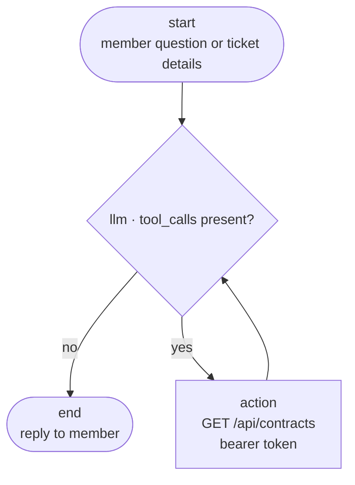

# OpsLookup Reference

The "if I forget" document. `README.md` covers how to run it; this covers **why it is
built this way**, the decisions that are easy to lose, and every problem hit along the
way with its symptom and fix.

---

## 1. Quick start

Two services, two terminals.

```powershell
# Terminal 1 — .NET API, owns SQL Server
cd "D:\Projects\Operation RAG\src\OpsLookup.Api"
dotnet run

# Terminal 2 — Python agent + web page
cd "D:\Projects\Operation RAG\src\OpsLookup.Graph"
.\.venv\Scripts\uvicorn api:app --port 8000
```

Or the launcher, which preflights the environment and opens the browser:

```powershell
.\start.ps1            # add -Reload while developing, -NoBrowser to suppress
```

Fastest way to verify everything still works without a model:

```powershell
.\.venv\Scripts\python.exe smoke_test.py     # headless, 20 assertions
code "Check API.ipynb"                        # 23 checks, select the opslookup kernel
code "Python Workflow.ipynb"                  # step-by-step walkthrough, real model
```

The smoke test is the one that covers the attorney tool. The notebook has not been
extended for it — it still exercises contracts only.

`Python Workflow.ipynb` is the teaching artifact: it runs the real model and shows the
message trace, the `toolCalls` / `lookupFailed` contract, and the failure modes. Two
things it gets right that are easy to get wrong elsewhere — it uses top-level `await`
rather than `asyncio.run()` (Jupyter already owns the loop), and it mints its own
service token from `/auth/dev-token` so a 60-minute expiry cannot break it.

---

## 2. Ports and URLs

| Port | Service | Notes |
|---|---|---|
| **5250** | .NET API, http | From `launchSettings.json`. Use this one. |
| **7163** | .NET API, https | Self-signed dev cert — httpx rejects it, see §7 |
| **8000** | Python agent + web page | |
| 5050 | .NET API, https only | unused profile |

| URL | What |
|---|---|
| http://localhost:8000 | Chat page for operations staff |
| http://localhost:8000/health | `{"status":"ok","api_reachable":true}` |
| http://localhost:8000/docs | Interactive API docs |
| http://localhost:5250/swagger | Swagger UI |
| http://localhost:5250/openapi/v1.json | Raw OpenAPI document |

**Ports 5250/7163, not 5199.** 5190/5199 appear nowhere in the project; those were
ad-hoc values used with `--no-launch-profile`. `launchSettings.json` is the source of
truth.

---

## 3. Architecture, and why it is split in two

```
operations member
        │  plain language
        ▼
┌───────────────────────────┐
│  OpsLookup.Graph (Python) │   LangGraph loop, two tools
│  static/index.html        │   chat page
└───────────┬───────────────┘
            │  HTTP + bearer token
            ▼
┌───────────────────────────┐
│  OpsLookup.Api (.NET)     │   EF Core, JWT
└───────────┬───────────────┘
            │  EF Core
            ▼
        SQL Server
```

**The rule that matters: only the .NET project may touch SQL Server.**

There is no database driver anywhere in the Python project — no `pyodbc`, no
`sqlalchemy`. It holds an HTTP client and a bearer token, nothing else. That is what
makes "the model cannot run arbitrary SQL" true rather than aspirational: the model
picks among a small set of named tools, and the .NET side resolves each one. There is
no path by which a generated string becomes SQL.

### Why Python at all

LangGraph has no .NET port. `tryAGI/LangGraph` does not exist on GitHub (404) and
there is no `LangGraph` package on NuGet. The `LangGraph.Agent.Templates` package is
Python templates that a `dotnet new` pack installs. LangGraph is Python-only.

Options considered:

| Option | Verdict |
|---|---|
| Python LangGraph service + .NET API | **Chosen** — real LangGraph, MS owns the data |
| `Microsoft.Agents.AI.Workflows` | Official .NET graph runtime, different API |
| Hand-rolled `StateGraph` in C# | Same mental model, no dependencies |

---

## 4. The graph



One conditional edge, in `graph/build.py`.

**A clarifying question and a final answer travel the same path.** Both are plain text
with no tool call, and both flow to `end`. That is why there is no separate
"needs_info" branch — the design does not need one.

Implementation notes:

- `MessagesState` supplies message history; `ToolNode` appends tool results. No custom
  state class.
- **A checkpointer is mandatory for multi-turn.** Without one, asking a follow-up
  question loses all context. `thread_id` is the ticket id. `AsyncSqliteSaver` in
  `api.py`; `InMemorySaver` in tests.
- **`RECURSION_LIMIT` (default 10) caps a single turn.** A model handed a confusing
  API response will retry forever otherwise.
- The system prompt forbids the model inventing a social ID. Without that instruction
  it will happily produce a plausible ten-digit number.

---

## 5. Data model and the decisions behind it

```
Contract (Id PK, Name nvarchar(200), Code bigint, CreatedDate)
Party    (Id PK, Name nvarchar(200), ContractId FK, SocialId bigint,
          AttorneyId FK NULL, CreatedDate)
Attorney (Id PK, Name nvarchar(200), Status nvarchar(20), CreatedDate)
```

| Decision | Reason |
|---|---|
| `SocialId` is `bigint`, safe | Social IDs are **10 digits starting with 1 or 2**, so a leading zero is impossible and nothing is lost. Had they been fixed-width with leading zeros, `bigint` would silently break every lookup. |
| `HasIndex(SocialId)` | Every request filters on it. Without the index every ticket is a table scan on `Party`. |
| `HasIndex(Party.Name)` | The attorney endpoint filters on party name. |
| `HasIndex(Code).IsUnique()` | Contract code is the business identifier. |
| `Party.Name` filter, **not** `Contract.Name` | The optional `name` query param was specified against the party. Getting this backwards is easy — the response returns both `partyName` and `contractName`. |
| Cascade delete from Contract → Party | An orphan party row is meaningless. |
| `Party.AttorneyId` is **nullable** | A party may have no attorney on file. A non-nullable FK would force every existing party to be backfilled with a fake attorney, and would let the schema imply a guarantee the data does not make. |
| `SetNull` on Party → Attorney | Removing an attorney must not remove the parties they acted for. |
| `Attorney.Status` is `nvarchar`, not an int enum | Readable in the database, and adding a value does not renumber existing rows. |
| EF Core **code-first**, no stored procedures | Requested. The migration files **are** the schema history and must be committed. |
| Seed in `DevSeeder`, not `HasData` | `HasData` bakes demo rows into migration history, where real data must never end up. Gated on `IsDevelopment()`. |

### Validation rules

`Security/SocialIdRule.cs` — `^[12]\d{9}$`.

This exists because a mistyped social ID and a non-existent one both return an empty
result set. Without the check an operations member reads "no contracts found" as "this
customer does not exist" — a **wrong answer** rather than a failed lookup. It returns
400 with a plain message instead.

`Security/AttorneyStatus.cs` — `approved` or `faked`.

Enforced twice on purpose: validated in C# on the way in, **and** a `CK_Attorney_Status`
check constraint in the database. C# alone stops nothing — a script, EF raw SQL, or
someone in SSMS all bypass it. The constraint is the one that cannot be bypassed.

### A note on the seed data

`DevSeeder` seeds **only a completely empty database**. Adding a new seeded entity
therefore does nothing until the dev database is dropped:

```powershell
dotnet ef database drop --force --project src\OpsLookup.Api\OpsLookup.Api.csproj
```

This is deliberate and it is the one sharp edge in the seeder. Seeded rows are demo
data and are safe to discard, but silently not appearing is a confusing first
experience. The limitation is documented on `DevSeeder` itself.

---

## 6. API and tool contract

```
GET  /api/contracts?socialId={long}&name={string?}      -> 200 / 400 / 401
GET  /api/attorneys?socialId={long?}&partyName={string?} -> 200 / 400 / 401
POST /auth/dev-token                                  Development only
GET  /health                                            anonymous
```

```json
[
  {
    "contractCode": 100234,
    "socialId": 1234567890,
    "partyName": "A Nasser",
    "contractName": "Annual Maintenance Agreement"
  }
]
```

An empty array means no contracts matched. That is **not** an error.

### Attorneys

```json
[
  {
    "attorneyId": 1,
    "attorneyName": "Lena Fischer",
    "status": "approved",
    "partyId": 3,
    "partyName": "B Karimi",
    "socialId": 1987654321
  }
]
```

The response carries the **matched party**, not just the attorney. A member asking
"is my attorney approved?" needs confirmation that the attorney found is the one
attached to the party they asked about; returning `attorneyName` alone would let the
answer be about the wrong person.

`socialId` and `partyName` are both optional but **at least one is required**. With
neither, the endpoint would return every attorney on file — a data dump, not a lookup.

Parties with no attorney on file are excluded from the result, because there is no
attorney to report. `[]` therefore means "that party has no attorney on file", which
is a genuinely different answer from "the attorney is approved".

The query is anchored on `Party`, not `Attorney`: both filters describe the party, and
starting from `Attorney` would need a reverse navigation EF cannot express cleanly here.

### The tools

```python
get_contract(social_id: int, name: str | None = None) -> str
get_attorney(social_id: int | None = None, party_name: str | None = None) -> str
```

Typed parameters only. No SQL, no table name, no free-text filter expression. See §3.

Both tools return `{"results": [...]}` or `{"error": "..."}` as JSON text. Returning
errors as text rather than raising lets the model explain the failure to the member in
plain language instead of the run blowing up.

### Swagger UI token flow

1. `POST /auth/dev-token` → **Try it out** → **Execute** (no token needed)
2. Copy `accessToken` from the response
3. **Authorize** button → paste it

`/health` and `/auth/dev-token` deliberately render **without** a lock icon. The
operation transformer in `OpenApi/SwaggerConfiguration.cs` strips the security
requirement from anything marked `IAllowAnonymous`.

---

## 7. Problems hit, and their fixes

Every one of these failed silently or misleadingly. Worth remembering.

### Python

| Symptom | Cause | Fix |
|---|---|---|
| Tool returned nothing, `RuntimeWarning: coroutine ... was never awaited` | `StructuredTool.from_function` does **not** detect an async closure and wraps it as sync | Construct `StructuredTool(..., coroutine=get_contract)` explicitly |
| `RuntimeError: asyncio.run() cannot be called from a running event loop` | Jupyter already runs a loop | Top-level `await`. Never call `asyncio.run()` in a notebook cell |
| `os.getenv("API_BASE_URL")` returns `None`, `.env` looks ignored | `config.py` never called `load_dotenv()`; only entry points did. It failed silently because the var has a default | `load_dotenv()` inside `config.py` itself |
| Error responses look empty | PowerShell `Invoke-RestMethod` swallows error bodies | Use httpx or curl. It cost two false "fixes" |
| `ModuleNotFoundError: langgraph` in a notebook | Kernel was system Python 3.10; venv had no `ipykernel` | `pip install -r requirements-dev.txt` and register the `opslookup` kernel |

### .NET

| Symptom | Cause | Fix |
|---|---|---|
| `dev-token` returns 500 "Signing key not configured" | `AddSingleton(jwtOptions)` registers the **concrete type**, so `IOptions<JwtOptions>` resolved a default-constructed instance with an empty key | `AddOptions().Configure<JwtOptions>(section)` |
| `InvalidOperationException: The LINQ expression ... could not be translated` | `.OrderBy()` applied **after** the projection, so EF tried to order by the whole `new ContractResult(...)` | Order before `Select` |
| `Cannot insert explicit value for identity column` | Seeder supplied explicit keys; EF makes `Id` IDENTITY by convention | Let the DB generate; wire contracts by navigation property |
| `CS1061: 'OpenApiDocument' does not contain a definition for 'Security'` | `Microsoft.OpenApi` 2.x only. net9 resolves 1.6.30 | Attach the requirement per-operation instead |
| `CS0234: 'Microsoft' does not contain 'OpenApi'` | `Microsoft.AspNetCore.OpenApi` 10.x on net9 resolves no `Microsoft.OpenApi` at all | Use 9.0.20 across the board |
| `/api/chat` returns 500 "The agent hit an unexpected error" for a *client* mistake | `ChatRequest` declares non-nullable `string TicketId`/`Message`, but ASP.NET does **not** enforce non-nullability. A body missing those fields deserialises to null, reaches the bridge, and throws | Validate in the endpoint and return **400**. A malformed request must not look like a server fault |
| `ArgumentOutOfRangeException: Unsupported argument type for the Python bridge` | `ToPy`'s fall-through arm also caught `null`, so a null string produced a message about a *type* | Explicit `null =>` arm. The real cause is always upstream of the bridge — read it as "a required argument was null" |
| `dotnet run` listens on 5036, Vite dev proxy targets 5100 | `start.ps1` passes `--urls http://localhost:5100`, but plain `dotnet run` uses `launchSettings.json`, which said 5036 | Set `applicationUrl` in `launchSettings.json` to 5100 so both paths agree |
| `CS0021: Cannot apply indexing with [] to LocalView<Attorney>` | `db.Set<T>().Local` is a `LocalView<T>`, not a list | Hold the entity in a local variable and assign it by navigation; EF fills the FKs |
| New seeded entity does not appear | `DevSeeder` seeds only a **completely empty** database | `dotnet ef database drop --force`. Deliberate, and documented on the seeder |
| Header and footer float with dead space below | Replacing `main.css` dropped `html, body, #app { height: 100% }`, which the shell's `h-full` depends on | Restore it in `@layer base` |
| Theme toggle appears dead in a test | Vue watchers flush on the next tick; reading `localStorage` synchronously right after `.click()` shows the old value | `await` a tick before asserting. `aria-pressed` updates immediately and proves the click landed |
| A good answer is badged red | `any_tool_error` scanned the whole transcript, but the checkpointer replays the entire thread, so a failure from an earlier turn poisoned later turns | Scan only messages after the last `HumanMessage` |
| `SyntaxError: Unexpected token ''` building the client | PowerShell `Set-Content -Encoding UTF8` writes a **BOM**, and Node's JSON loader rejects it | Write with `[System.IO.File]::WriteAllText($p, $text, (New-Object System.Text.UTF8Encoding($false)))` |
| Arabic crashes a test run with `UnicodeEncodeError: 'charmap'` | Console is cp1252 and cannot print Arabic. Not an application fault | Set `PYTHONIOENCODING=utf-8`. `host.py::_log` already opens `progress.log` with `encoding="utf-8"`, so real log writes are safe |

### Deploying to IIS

An SDK Web project copies **only** compiled assemblies and `wwwroot`. It does not copy
arbitrary folders, so nothing under `Python/` shipped and the host reported the venv as
missing. The csproj now has explicit `Content` items for `Python/**`.

Three traps in that change:

| Trap | Why it bites |
|---|---|
| `.env` gets published | MSBuild globbing is **filesystem-based, not git-based**. `.gitignore` gives no protection; `Content Include="Python/**"` would ship the live `LONGCAT_API_KEY` and `API_TOKEN`. The `Exclude` is load-bearing. |
| Nested `__pycache__` survives | `Python\__pycache__\**` only matches the top level. Needs `Python\**\__pycache__\**`. |
| `checkpoints.sqlite` ships | Runtime state left behind by a local run. Excluded explicitly. |

Two path bugs that only appear once the app leaves `dotnet run`:

- **Relative config paths resolved against the working directory.**
  `Path.GetFullPath("Python")` uses `Environment.CurrentDirectory`. That equals the
  project folder under `dotnet run` and is unrelated to the app folder under IIS — it
  appeared to work there only because that host happened to set the working directory to
  the application directory. `ResolveAgainstApp` now anchors to `AppContext.BaseDirectory`
  and falls back to the working directory when that is where the file actually lives; the
  fallback is what keeps `dotnet run` working, since the venv sits beside the project file
  rather than beside the built binary.
- **Python wrote diagnostics inside the app folder.** `logs/` and the SQLite checkpointer
  defaulted to `Python/`, which the app pool identity cannot write to in practice. Both
  now derive from `OPSLOOKUP_DATA_DIR`, which should point at somewhere writable such as
  `C:\ProgramData\AI.TicketingAssistant`.

The **stderr hazard** is the one that does not fail loudly. langchain and langgraph create
their own loggers; with no root handler, Python's last-resort handler writes anything at
WARNING or above to `sys.stderr`. IIS gives the process no console, and a blocked stderr
write happens *while holding the GIL*, which stalls every `Py.GIL()` call in .NET. The
symptom is requests that hang with no error and no log line. `host.py::_configure_logging`
installs a file handler on the root logger before the library imports, which both
suppresses that fallback and captures the diagnostics.

Not fixed by any of the above: **IIS recycles app pools** (20-minute idle by default) and
each recycle pays the 60–120s `langgraph` import again. `Always Running` and preloading
reduce it; hosting as a Windows Service removes it.

#### Deploying with `tools/deploy.ps1`

Everything above was originally done by hand, in an order that turned out to matter. It is
now a single idempotent script:

```powershell
# first run needs the LongCat key; later runs reuse the deployed one
.\tools\deploy.ps1 -LongCatApiKey oc_sk_xxx -Seed

# routine redeploy - reuses the existing signing key and service secret
.\tools\deploy.ps1
```

It checks prerequisites, creates the database and SQL principal, applies migrations,
publishes both apps, writes configuration, then **verifies**: dev-token must 404, the
service token must work, the agent must warm up. A run that cannot prove those passed is a
run that failed, however clean the output looked.

It reuses whatever secret is already deployed rather than generating a new one, so a
redeploy does not invalidate every token in flight.

Three things it deliberately does **not** do:

- It does not put `<environmentVariables>` in `web.config`. See below.
- It does not grant `db_owner`. Migrations are applied by the script; the application
  itself only needs `db_datareader` + `db_datawriter`.
- It does not write an `API_TOKEN`. The agent is handed a token per turn.

#### Three traps that each produce a misleading error

**`<environmentVariables>` in `web.config` is rejected on this machine.** IIS returns
`500.19 / 0x8007000d` with "Config Source: -1: / 0:" — pointing at the *start of the
file*, which is not where the problem is. `environmentVariables` is not defined as a
config section in this `applicationHost.config`, so IIS cannot parse the block even though
the surrounding XML is valid. Removing the block makes the site serve again immediately.
This was the cause of the original `500.19`, not a BOM.

The consequence is that app-pool environment variables are the only way to keep secrets out
of the web root, and setting those needs elevation — which is why the script falls back to
`appsettings.Production.json` (not HTTP-servable, verified 404) when it is not elevated, and
says so.

**`localhost` does not resolve for the app-pool identity.** It resolves to `::1` first; the
data API is not listening there, and `httpx` does not fall back to IPv4 the way a browser
does. Every lookup failed with a connection error while the API was plainly up on
`http://127.0.0.1:3030/health`. Both `.env` and `Lookup:BaseUrl` use `127.0.0.1`.

**A UTF-8 BOM in `web.config` is also `500.19`.** Same error code, different cause. Write it
with `[System.IO.File]::WriteAllText($f, $xml, (New-Object System.Text.UTF8Encoding($false)))`.

One bug only became visible because of the per-turn token change: `LookupApiClient` used to
send `Authorization: Bearer {token}` unconditionally, so with no token it sent a header with
**no value** — which `httpx` rejects with `LocalProtocolError`. `health()` catches that as
an `HTTPError` and returns `False`, so the API reported as unreachable while being perfectly
fine. The header is now only set when a token exists. This is why `/api/health` reporting
`apiReachable: false` is worth believing.

#### Runtime state outside the web root

`checkpoints.sqlite` and `logs/` were being written into `Python/` under
`C:\inetpub\wwwroot`, which is wrong twice over: the app pool identity should not be able to
write there, and **each publish overwrote the diagnostics along with the code they describe**
— so the evidence needed to explain a failed deployment is destroyed by the deployment.

`PythonBridge.ApplyDataDirectory` resolves it before `PythonEngine.Initialize()`, because
`host.py` reads `OPSLOOKUP_DATA_DIR` at import time and a value set later arrives too late. It
falls through `OPSLOOKUP_DATA_DIR` → `%ProgramData%\AI.TicketingAssistant\data` → `%TEMP%`, and
**probes each candidate by writing and deleting a real file** — a directory can exist and still
be unwritable, and discovering that from a SQLite error inside Python is much harder than
discovering it here. `deploy.ps1` creates the directory as the deployer and grants the app pool
`Modify`, which succeeds unelevated because the deployer owns the folder it just made. The
deployment then verifies the checkpoint file actually appears there, because asserting the
directory exists proves nothing — the failure mode is Python writing there anyway.

Secrets are placed **before** the settings file is written, and only appear in it if the app
pool could not take them. The earlier version wrote them unconditionally and then asked you to
remove them afterwards. Once they live in the app pool they are deliberately absent from the
file, so the next run reads them from the app pool — otherwise every elevated run generates a
fresh pair and quietly invalidates every issued token.

One trap: `host.py` writes logs to `$OPSLOOKUP_DATA_DIR/logs`, *inside* the data directory.
Creating `%ProgramData%\AI.TicketingAssistant\logs` instead yields an empty directory that never
receives anything, which reads as "logging is broken".

#### Publishing over a running site

Publishing straight into the site folder fails with `MSB3027` — *"the file is locked by
w3wp.exe"* — and MSBuild retries ten times first, so it presents as a hang. Dropping
`app_offline.htm` into the site root releases the lock without needing to stop the app pool;
`deploy.ps1` writes it, publishes, and removes it in a `finally`.

The failure was invisible at first because the publish step piped to `Out-Null`, so the script
reported `publishing the API failed` with no reason attached. Build output is now surfaced on
failure.

#### Two long-standing silent problems

**The Python trees had drifted.** `graph/build.py` in the embedded copy still carried older
Arabic wording — `رقم الهوية الوطنية` (national ID) and `الوكالة` (the agency) — while the UI
used `الرقم الاجتماعي` (social ID) and `محامي` (attorney). An operator clicking the Arabic
example button saw the agent talk about a *national ID* and an *agency*, contradicting the
prompt they had just clicked. Nothing enforced the two copies matching; they now differ only
in `api.py` (dev entry point) and `host.py` (IIS host), and `deploy.ps1` **hash-checks every
shared `.py` and refuses to deploy on drift**.

**`smoke_test.py` still required a long-lived `API_TOKEN`.** When `.env` stopped carrying one —
which is correct, since an `API_TOKEN` in a file is exactly the credential the agent should not
hold — the test failed with *"The lookup API rejected the service token"*, having silently
stopped testing the lookup path at all. It now mints its own 30-minute token from the
Development-only `dev-token` endpoint, which is what that endpoint is for. It is also excluded
from publish: it is a dev-only test and has no business in a web root.

### Front end

Tailwind v4, configured in CSS rather than `tailwind.config.js`. Tokens live in
`@theme` in `ClientApp/src/assets/main.css`, which is why `bg-canvas` / `text-muted` /
`border-line` work without any config file. Dark mode is a `@custom-variant` keyed off
a `.dark` class on `<html>`; the theme colours are re-declared under `.dark` so anything
driven by a token flips without needing its own `dark:` variant.

Two things that are load-bearing rather than decorative:

- **`services/markdown.ts` sanitises before `v-html`.** Replies contain database-sourced
  text. Without DOMPurify a contract name could run script in the operator's browser.
- **The badge has three states.** See the badge section in `README.md`; collapsing
  "lookup failed" into "looked up N times" is the easy regression to reintroduce.

### Arabic and RTL

The page is Arabic by default with an Arabic/English switch. `useI18n.ts` owns the
locale and sets `lang` and `dir` on `<html>`; Tailwind's logical utilities (`ps-`,
`pe-`, `me-`, `text-start`) key off `dir`, so components carry no direction-specific
branches. An inline script in `index.html` applies `dir` before first paint — otherwise
an Arabic user gets a visible left-to-right flash before it flips.

Decisions worth keeping:

| Decision | Reason |
|---|---|
| Replies follow the selected language | An Arabic UI beside an English answer is two languages at once. The locale is carried on the request into `system_prompt()`. |
| System prompt selected per **turn**, not per graph | The locale lives in turn state, so two turns on one thread can differ. Capturing it in the compiled closure would freeze the first turn's language. |
| Unknown locale falls back to Arabic | An older client sending no `locale` must still get an answer, not a 422. |
| Western digits in Arabic | Business users in Egypt and the Gulf read Latin digits, and a social ID is data — rendering Arabic-Indic numerals would make the number wrong. |
| Arabic gets `line-height: 1.75` | Arabic ascenders and descenders collide at Latin line heights. |
| No Arabic webfont | The page is built to run on an isolated network with no external requests. The font stack uses fonts that ship with Windows and macOS. |
| Arabic has separate singular/plural badge strings | `مرة واحدة` is not `"time" + (n === 1 ? '' : 's')`. The English plural trick produces nonsense in Arabic. |

Enter-to-send guards on `event.isComposing`. An Arabic IME fires `keydown` while the
word is still being composed, and Enter there means "confirm", not "send" — without the
guard, sending mid-word is routine rather than rare.

### LongCat

| Symptom | Cause | Fix |
|---|---|---|
| `MissingSessionID` | The Zen gateway requires `x-opencode-session`. A generic OpenAI client (httpx, langchain-openai) does not send it. | `config.py` sets it via `default_headers()` when the base URL is `opencode.ai/zen` |
| Gateway wants clients to identify themselves | Same root cause | Same `User-Agent` header |
| `requires Global regions` | Workspace region entitlement, not a code problem | Account-level; no code change helps |

**Correction.** This project originally recorded that the Zen gateway "cannot be
called directly" and that the LongCat platform API was required. **That was wrong.**
The gateway is callable from an application — it just requires two headers that the
OpenAI SDK omits. The .NET project proved this: its `OpenCodeGoHeadersPolicy` injects
`x-opencode-session` and `User-Agent` before the transport, which is why the same
endpoint works there and not here. `config.py` now does the equivalent for Python.

Both endpoints are valid. They differ in cost and capability:

| | Zen gateway (`opencode.ai/zen/go/v1`) | Platform (`api.longcat.chat/openai/v1`) |
|---|---|---|
| Auth | `oc_sk_…` key | LongCat platform key |
| Extra headers | **Required** — `x-opencode-session`, `User-Agent` | None |
| Model id | `longcat-2.5-preview-free` | `LongCat-2.5-Preview` |
| Cost | Included in the workspace allowance | ~$0.30/1M in, $1.20/1M out |

Whichever is configured, the headers are attached automatically only for the Zen URL,
so switching is a two-line `.env` change.

---

## 8. Troubleshooting

| Symptom | Likely cause | Do this |
|---|---|---|
| `ConfigurationError: LONGCAT_API_KEY is required` | Key missing | Add to `.env` |
| `MissingSessionID` | Zen gateway did not get `x-opencode-session` | Should be automatic; check `LONGCAT_BASE_URL` is spelled correctly |
| `requires Global regions` | Workspace region entitlement | Account-level, not a code issue |
| `"api_reachable": false` | .NET API down, or wrong port | `dotnet run`, check `API_BASE_URL` |
| 401 in the API logs | `API_TOKEN` expired — dev tokens last **60 minutes** | Re-mint: see below |
| `CERTIFICATE_VERIFY_FAILED` | `API_BASE_URL` is https; dev cert is self-signed | Use the http URL |
| Page works, but replies have **no "Looked up" badge** | Model can chat but cannot emit `tool_calls` — **every answer is a hallucination** | Stop. Fix the endpoint, verify `toolCalls` is 1 |
| `Address already in use` | An old instance is running | Kill it, or use the other port |
| Swagger shows no Authorize button | Security scheme not applied | Check `OpenApi/SwaggerConfiguration.cs` |

Re-mint a token:

```powershell
$tok = Invoke-RestMethod "http://localhost:5250/auth/dev-token?operatorId=op-4471" -Method Post
(Get-Content .env) -replace '^API_TOKEN=.*$', "API_TOKEN=$($tok.accessToken)" | Set-Content .env
```

Kill a stuck process:

```powershell
Get-CimInstance Win32_Process -Filter "Name='python.exe'" |
  Where-Object { $_.CommandLine -like "*uvicorn*" } |
  ForEach-Object { Stop-Process -Id $_.ProcessId -Force }
```

---

## 9. Version constraints

| Component | Version | Why pinned |
|---|---|---|
| .NET | **net9** | Chosen. Note the OpenAPI 10.x incompatibility in §7 |
| `Microsoft.AspNetCore.OpenApi` | 9.0.20 | 10.x does not work on net9 |
| `Swashbuckle.AspNetCore.SwaggerUI` | 10.3.0 | |
| EF Core (SqlServer, Design) | 9.0.20 | Must match the migration's `ProductVersion` |
| Python | 3.14 venv | |
| `langgraph` | 1.2.14 | |
| `langchain-openai` | 1.6.7 | |
| Model | `LongCat-2.5-Preview` | No structured output; **tool calling works** |

LongCat has **no structured-output support**, so the design does not depend on the
model emitting schema-validated JSON. Completion is signalled by the absence of a tool
call. Tool calling is supported and is the load-bearing capability.

---

## 10. Making changes

**Add a lookup:** tool in `tools/contracts.py` (typed params) + endpoint in
`Endpoints/`. Keep SQL in .NET.

**Add a field to the response:** entity property, then `.Select(...)` in
`ContractRepository`, then `ContractResult`. Add to `ContractEndpoints.Produces<T>()`.

**Change the schema:**

```powershell
dotnet ef migrations add <Name> --project src\OpsLookup.Api\OpsLookup.Api.csproj
dotnet ef database update  --project src\OpsLookup.Api\OpsLookup.Api.csproj
```

`dotnet-ef` is installed globally at 9.0.20. Migration files must be committed.

---

## 11. Security notes

### Service credentials (how the agent authenticates)

The agent host mints its own token **per turn** and hands it to Python as a plain
string argument. Python has no way to obtain a token.

```
PythonBridge.ChatAsync
  ├─ ServiceTokenClient.GetTokenAsync()   POST /auth/service-token  + X-Service-Secret
  └─ run_turn(threadId, message, operatorId, locale, apiBaseUrl, apiToken)
```

Rules that are easy to undo by accident:

| Rule | Why |
|---|---|
| The shared secret lives in **.NET** config, never in Python's `.env` | A bug or prompt injection in the agent must not be able to mint API access |
| `ServiceSecret` must be set via the **`Jwt__ServiceSecret` environment variable** | `appsettings.Production.json` sits in the web root, which is how a key ended up in one once |
| `ServiceSecret` is **separate from `SigningKey`** | Reusing it means anything that can request a token can also forge one |
| `ServiceSubject` comes from config, never the request | The dev endpoint lets the caller pick `operatorId`; a machine identity should not choose who it is |

The secret is compared with `CryptographicOperations.FixedTimeEquals`. A plain `==`
leaks it byte-by-byte.

`load_settings(require_api_token=...)` exists because `host.py` no longer reads
`API_TOKEN` from `.env` but still calls `load_settings()`, which used to raise when it
was absent. The standalone `api.py` keeps the strict default — it has no host to hand
it a token, so a missing one there is a real misconfiguration.

**No caching, deliberately.** One extra localhost call against a fifteen-second model
turn costs nothing and removes every staleness question a cache would raise. Prove it by
setting `Jwt:ServiceTokenMinutes=1`, running a ticket, waiting longer than that, and
running another — the second must still succeed.

### The dev-token endpoint

`POST /auth/dev-token` is anonymous and lets the caller choose both the subject and the
lifetime, so it is mapped **inside an `IsDevelopment()` check**. It was previously mapped
unconditionally: on the IIS deployment anyone who could reach the port could mint a
year-long token with `?minutes=525600` and read every contract and attorney row.
`minutes` is now clamped to 480.

Do not move that `MapDevTokenEndpoints()` call out of the `if`. An open dev-token
endpoint in production is a data breach.

- JWT is **symmetric-key** validation for local development. `Program.cs` refuses to
  start in Production if `Jwt:SigningKey` is missing or under 32 characters. Swap
  `AddJwtBearer` for OIDC validation when there is a real IdP.
- `/auth/dev-token` is registered **only** under `IsDevelopment()`. It cannot ship.
- The Python service sends `X-Operator-Id` so the API can attribute a lookup. That
  header is not cryptographically bound to the member's identity — proper token
  exchange is the upgrade if that matters.
- **A `LONGCAT_API_KEY` was pasted into a chat conversation and must be rotated.**
  `.env` is gitignored, but conversation logs are not.
- EF Core parameterizes everything by default. `Name.Contains(x)` becomes a
  parameterized `LIKE '%x%'` — never string-concatenated SQL.

---

## 12. Open items

- [ ] **`LONGCAT_API_KEY` rotated.** It was pasted in plaintext in chat and also sat in
      `src/OpsLookup.Graph/.env.example`, which is **committed**. The example file has
      been scrubbed, but the key itself is still the exposed one — rotate it.
- [x] Tool calling verified against the Zen gateway: `{"social_id": 1234567890}`,
      real rows returned, grounded reply
- [x] `toolCalls == 1` confirmed in `/chat` responses, both for contracts and for
      attorneys, including through the web page.
- [x] Attorney endpoint and tool covered: approved status, `faked` status, lookup by
      partial party name, the no-attorney case, and a rejected social ID. 20 assertions
      in `smoke_test.py`.
- [x] `CK_Attorney_Status` proven to reject a bad value via direct SQL, not just via C#.
- [x] `/auth/dev-token` gated behind `IsDevelopment()`; `minutes` clamped to 480.
- [x] Service token minted per turn by .NET, never cached, never held by Python. Proven by
      running with `Jwt:ServiceTokenMinutes=1`, waiting past expiry, and taking a second turn
      successfully.
- [x] App runs as `db_datareader` + `db_datawriter` instead of `db_owner`.
- [x] `tools/deploy.ps1` — one idempotent script replaces the whole manual procedure, and
      fails the run if dev-token is reachable or the service token does not work.
- [x] Runtime state (`checkpoints.sqlite`, `logs/`) moved to
      `%ProgramData%\AI.TicketingAssistant\data`, out of the web root.
- [x] Secrets placed in app-pool environment variables first; written to
      `appsettings.Production.json` only if that fails.
- [ ] Rotate `LONGCAT_API_KEY` — it was exposed in plaintext and also sat in the deployed
      `Python\.env` before the csproj `Exclude` was added.
- [ ] Re-run `.\tools\deploy.ps1` **elevated** to finish moving
      `Jwt:SigningKey` and `Jwt:ServiceSecret` out of the web root. Needs administrator.
      `<environmentVariables>` in `web.config` is not an option on this IIS.
- [ ] Decide internal tool vs real users — this determines whether hosting as a Windows
      Service (removing the 60–120s recycle cold start) is worth doing.
- [ ] Swap symmetric JWT for OIDC if a real identity provider exists
- [ ] Confirm Swagger's **Execute** button by hand — it was verified for Authorize
      only, because headless automation cannot render Swagger UI's React body